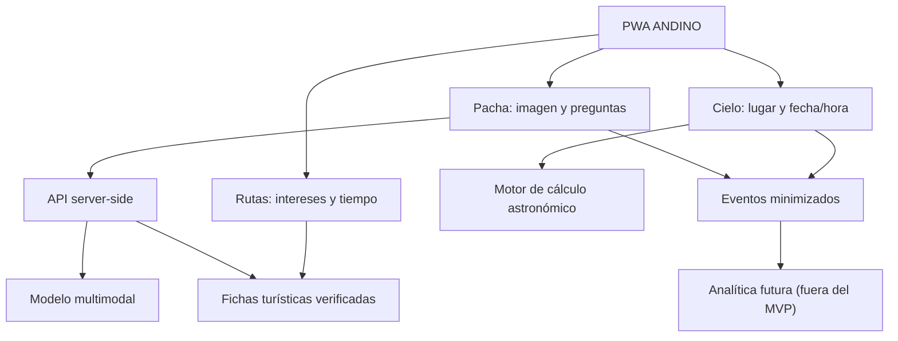

# ANDINO — Plan de proyecto | Cursor Hackathon Jujuy

> Versión 4 · 22 de noviembre de 2026  
> **Enfoque:** astroturismo en la Quebrada y la Puna de Jujuy  
> **Tagline:** «Tu mejor noche de cielo en Jujuy»  
> **Equipo:** `lautioliver` (Desarrollador 1, ficha del lugar e integración) y `jehp23` (Desarrollador 2, motor del cielo y demo)  
> **Contexto:** hackathon en el Tren Solar, con temática vinculada a Cursor y la comunidad espacial/SpaceX mencionada por el equipo. No implica patrocinio, integración ni colaboración oficial de SpaceX.

> **Por qué cambió el plan (v3 → v4):** los mentores señalaron que la versión anterior no tenía un problema real ni un nicho claro; lo único que les interesó fue el cielo. Dejamos de ser «turismo inteligente en general» y nos enfocamos en una persona y un problema concretos. El Gobierno provincial deja de ser el cliente objetivo de la demo.

## 1. Visión

**ANDINO — Tu mejor noche de cielo en Jujuy.**

Una PWA que acompaña al viajero que llega a la Quebrada y la Puna a vivir el cielo: le dice **cuándo** salir, le enseña **adónde** mirar con el celular y le explica **qué significa** lo que ve, desde la astronomía y desde el cielo andino.

**Propuesta diferencial:** la astronomía es el producto, no la decoración. Las posiciones del Sol, la Luna, las estrellas y los satélites salen de un motor de cálculo real para el lugar y la fecha del viaje; la IA solo explica.

**Palabras para el jurado:** «astronomía» y «astroturismo». Nunca «astrología».

## 2. Problema y nicho

**Nicho:** el viajero de la Quebrada y la Puna que viene, entre otras cosas, a vivir el cielo. Incluye al perfil espiritual o alternativo que busca el cielo andino, además del aficionado a la astronomía y del turista que «quiere ver las estrellas».

**Problema:** está bajo un cielo excepcional y se va sin verlo ni entenderlo, porque:

- **Elige mal la noche:** no sabe que la Luna llena tapa casi todo, ni a qué hora sale o se pone la Luna en las fechas de su viaje.
- **Sale a mala hora:** no sabe cuándo termina de oscurecer.
- **Mira desde el lugar equivocado:** desde el pueblo iluminado o con cerros que tapan el horizonte.
- **No sabe qué está viendo:** reconoce, como mucho, las Tres Marías y la Cruz del Sur.

**Validación pendiente:** este problema es nuestra hipótesis, armada con la devolución de los mentores y nuestra experiencia. No tenemos cifras de visitantes ni de demanda; no las inventamos en el pitch. Ver la sección 3.

**Clientes posibles (no validados, solo para el pitch de visión):** hospedajes y operadores de turismo astronómico de la región, y el área de turismo provincial. Ninguno está confirmado.

## 3. Validación: 5 conversaciones con viajeros

Antes de presentar, el equipo habla con **5 viajeros** (en el Tren Solar, en Purmamarca, Tilcara o Humahuaca). Conversaciones cortas, sin guion cerrado:

1. ¿Viniste, entre otras cosas, por el cielo? ¿Ya saliste a mirarlo?
2. ¿Cómo elegiste la noche y la hora? ¿Sabías cómo estaba la Luna?
3. ¿Desde dónde miraste? ¿Había luces o cerros?
4. ¿Qué reconociste? ¿Te hubiera gustado saber qué era cada cosa, o qué veían los pueblos andinos?
5. ¿Pagarías o reservarías algo para tener una buena noche de cielo? ¿Qué?

**Registro:** por cada conversación, una línea con lo que dijo (sin nombre ni datos personales) y si confirma o contradice el problema. Si en el pitch citamos a alguien, es textual y con su permiso. Si las conversaciones contradicen la hipótesis, se ajusta el producto, no el relato.

## 4. El producto en 3 pasos

El punto de observación es el eje: cada paso trabaja sobre un lugar concreto (Purmamarca, Tilcara, Humahuaca y los que se sumen).

### 4.1 Cuándo — la mejor noche del viaje (P0)

El viajero indica dónde está y qué noches tiene. ANDINO calcula, con el motor actual, la puesta del Sol, el fin del crepúsculo, la fase de la Luna y su salida y puesta, y recomienda **la mejor noche y la franja horaria más oscura**, explicando por qué.

**Ya existe:** «Esta noche» en la ficha del lugar (puesta del Sol, fase de la Luna, objetos visibles) y los pasos visibles de satélites Starlink. **Falta:** comparar varias noches del viaje y calcular la franja oscura.

**Límite:** sin datos meteorológicos confiables no prometemos cielo despejado; lo decimos.

### 4.2 Apuntá — el celular al cielo (P0 si funciona en el teléfono real)

Con geolocalización y brújula del teléfono, el viajero apunta al cielo y ve qué hay en esa dirección, de noche y también de día (dónde está la Luna, por dónde saldrá una constelación). **Plan B:** girar el cielo con el dedo, que ya funciona en la vista de cielo inmersiva.

**Regla:** si la brújula no es confiable en el dispositivo de la demo, se muestra el plan B. No se simula orientación.

### 4.3 Qué significa — constelaciones, cielo andino y tu signo (P0 acotado)

- **Constelaciones occidentales** principales visibles esa noche.
- **Cielo andino:** las constelaciones oscuras de la Vía Láctea (por ejemplo la Yacana, la llama). Fuentes académicas de Perú y Bolivia, citadas con autor y obra. No equiparamos automáticamente figuras occidentales con andinas ni atribuimos relatos a comunidades sin respaldo; para una versión pública, revisión de referentes culturales.
- **Tu signo en el cielo:** dónde está *de verdad* la constelación de tu signo esa noche (posición real, incluida la diferencia con las fechas del horóscopo). **Sin predicciones.** Es una puerta de entrada para el perfil espiritual, contada como astronomía.

### 4.4 La ficha del punto de observación (antes, Pacha)

Pacha deja de ser un producto aparte: es la **ficha del lugar**. Reconoce el paisaje por foto o permite elegirlo, explica geografía e historia con fuentes y, sobre todo, informa lo que importa para observar: si el horizonte está despejado, cuánta luz hay cerca, cómo llegar y cuidados (altura, frío, seguridad).

### 4.5 Visión a futuro (no va en la demo)

- **Estado del territorio en tiempo real:** nubosidad, viento, accesos y contaminación lumínica por punto de observación.
- Panel para hospedajes y operadores; reservas de salidas guiadas.
- Monitoreo de vegas y bofedales (Salud Andina), sujeto a validación con especialistas.

## 5. La demo y el alcance

### 5.1 Recorrido de la demo

1. **Llegada:** el viajero está en un lugar de la Quebrada (por ejemplo Tilcara) con tres noches de viaje.
2. **Cuándo:** ANDINO compara las noches y recomienda una, con la hora en que termina de oscurecer y dónde está la Luna.
3. **Dónde:** la ficha del punto de observación explica por qué conviene ese lugar y no el centro del pueblo.
4. **Apuntá:** el celular al cielo (o el plan B con el dedo) muestra lo que hay en esa dirección.
5. **Qué significa:** la Yacana en la Vía Láctea, con su fuente, y «tu signo en el cielo» para alguien del público.
6. **Visión:** una frase sobre el estado del territorio en tiempo real y los posibles clientes.

**Mensaje para el jurado:** «Jujuy tiene un cielo excepcional y la mayoría de los viajeros se va sin verlo. ANDINO les dice cuándo salir, adónde mirar y qué están viendo». No afirmar que SpaceX provee tecnología o datos al producto.

### 5.2 Alcance priorizado

| Prioridad | Entregable | Definición de terminado |
|---|---|---|
| P0 | Cuándo: la mejor noche | Lugar + noches del viaje → noche recomendada, franja oscura y Luna, calculadas |
| P0 | Qué significa | Constelaciones visibles + Yacana con fuente + tu signo en su posición real |
| P0 | Ficha del punto de observación | 3–5 lugares con datos para observar y fuentes |
| P0 | PWA mobile-first y demo robusta | Usable en un teléfono real; funciona con mala conectividad |
| P0/P1 | Apuntá | Brújula si funciona en el dispositivo real; si no, girar con el dedo |
| P1 | Reconocimiento del lugar por foto | Ya existe; se mantiene como entrada a la ficha |
| P2 | Transición Tierra → Cielo | Visual, sin bloquear lo anterior |
| Fuera del MVP | Estado del territorio en tiempo real, panel institucional | Solo en el pitch, como visión |

**Regla de corte:** si a mitad del tiempo «Cuándo» o «Qué significa» no funcionan, se frena todo lo demás. Una noche bien recomendada y bien explicada vale más que cinco funciones a medias.

## 6. Arquitectura



**Stack sugerido:** Next.js + TypeScript + Tailwind CSS; API multimodal configurable; PostgreSQL/Supabase para fichas y eventos; biblioteca astronómica con efemérides comprobables (por ejemplo Astronomy Engine o equivalente); mapa ligero opcional; despliegue en Vercel o equivalente.

**Separación importante:** los cálculos de posiciones celestes provienen del motor astronómico; la IA explica los resultados, **no inventa coordenadas ni visibilidad**.

### Datos mínimos

- `places`: id, nombre, región, coordenadas aproximadas, descripción, fuentes, imágenes autorizadas.
- `sky_objects`: id, nombre, tipo, ficha educativa y fuente.
- `itineraries`: id, lugares, duración estimada, advertencias, estado de validación.
- `interaction_events`: timestamp, módulo, lugar seleccionado, categoría; sin identificación personal obligatoria.

## 7. Diseño

**Identidad:** territorio andino + cielo nocturno; estética tecnológica sobria, evitando clichés culturales.

**Pantallas MVP:** Inicio (Tierra/Cielo) → Pacha (cámara) → Resultado con fuentes → Cielo (selector de hora/lugar y mapa). Ruta sugerida solo si sobra tiempo; panel institucional fuera del MVP.

**Momento visual central:** transición entre un paisaje de la Quebrada y el cielo nocturno calculado para ese mismo lugar.

## 8. Seguridad, precisión y ética

- Permisos explícitos de cámara y ubicación; opción manual sin GPS.
- No almacenar fotografías ni coordenadas precisas por defecto.
- Claves de IA en servidor, límites de uso y validación de archivos.
- Identificar respuestas inciertas y citar fuentes de patrimonio.
- No atribuir tradiciones astronómicas a comunidades sin respaldo.
- No prometer condiciones óptimas para astroturismo sin datos meteorológicos y de seguridad.
- Dashboard con métricas de **uso de la app**, nunca equivalentes a conteos de turistas.
- Sin uso de marcas o logos de SpaceX que sugieran asociación oficial.

## 9. Organización de desarrollo — dos personas

**Principio:** dividir por funcionalidades completas (*vertical slices*), no por frontend/backend. Cada desarrollador implementa interfaz, lógica y pruebas de su módulo; ambos comparten contratos mínimos y revisan los cambios críticos.

| Responsabilidad | Desarrollador 1 — `lautioliver` | Desarrollador 2 — `jehp23` |
|---|---|---|
| Módulo principal | **Pacha**: turismo, captura de imagen, IA y fuentes | **Cielo Andino**: mapa celeste y cálculo astronómico |
| Entrega P0 | Foto o destino → explicación con fuentes → pregunta | Lugar y fecha/hora → objetos celestes visibles y fichas |
| Responsabilidad transversal | Integración de `main`, API, despliegue y estabilidad | UX conjunta, pruebas en móvil y preparación de la demo |
| Colaboración | Revisar PRs de Cielo y definir contratos | Revisar PRs de Pacha y verificar navegación integrada |

### Repositorio y límites de propiedad

```text
andino/
├── app/
│   ├── page.tsx
│   ├── explorar/page.tsx
│   └── cielo/page.tsx
├── features/
│   ├── pacha/           # lautioliver
│   └── cielo/           # jehp23
├── shared/              # contratos acordados
├── data/                # fichas y ejemplos de demo
└── docs/plan.md
```

**Contratos antes de empezar:** `AndinoLocation { latitude, longitude, name }` y `ExplorationContext { location, timestamp, language }`. El paso Pacha → Cielo debe compartir la misma ubicación. No agregar un backend o base de datos si los datos estáticos resuelven el MVP.

**Git:** ramas breves `feat/pacha-*` y `feat/cielo-*`, PRs pequeños y revisión cruzada. `main` debe estar siempre desplegable. Integrar al menos una vez por hora; no esperar al final. Los cambios a `shared/` y configuración global se coordinan antes.

### Cronograma de referencia (7,5 horas; ajustar al evento)

| Tiempo | `lautioliver` | `jehp23` | Hito común |
|---|---|---|---|
| 0:00–0:30 | Scaffolding, API y contratos | Diseño base y dataset astronómico | Alcance P0 congelado |
| 0:30–1:30 | Pantalla Pacha y carga de imagen | Pantalla Cielo y selector de lugar/hora | Navegación funcional |
| 1:30–3:00 | IA + fichas turísticas curadas | Cálculos astronómicos + mapa simple | Dos flujos independientes |
| 3:00–4:00 | Pregunta de seguimiento y errores | Fichas de objetos y pruebas de cálculo | P0 funcional por módulo |
| 4:00–5:00 | Integración y revisión cruzada | Integración y revisión cruzada | Tierra → Cielo completo |
| 5:00–6:00 | Despliegue, fallback y correcciones | Pruebas en móvil y demo visual | Demo estable |
| 6:00–7:00 | Congelar código y apoyar pitch | Ensayar pitch y verificar dispositivo | Presentación ensayada |
| 7:00–7:30 | Reserva para contingencias | Reserva para contingencias | Entrega final |

**Regla de corte:** si a mitad del tiempo un flujo P0 no funciona, detener rutas, animaciones, voz y cualquier dashboard. Si falla el reconocimiento, usar selección manual de un destino; si falla la conexión, usar imágenes y respuestas precargadas identificadas como demo. No simular cálculos astronómicos como si fueran reales.

**Uso de agentes:** Cursor y, si resulta útil, el flujo ya conocido de Barrilete/bk-shell para tareas acotadas y revisión. No invertir tiempo del hackathon en configurar una nueva orquestación. La responsabilidad de integración sigue siendo humana.

## 10. Backlog

- [ ] AND-01: PWA mobile-first con navegación Tierra/Cielo.
- [ ] AND-02: Captura/carga de imagen y estados de error.
- [ ] AND-03: Dataset curado de 3–5 puntos del recorrido.
- [x] AND-04: Respuesta multimodal con fuentes y declaración de incertidumbre.
- [x] AND-05: Preguntas de seguimiento contextual.
- [ ] AND-06: Selector de lugar y fecha/hora para Cielo Andino.
- [ ] AND-07: Cálculo comprobable de posiciones de 3–5 objetos celestes.
- [ ] AND-08: Vista de cielo legible en móvil.
- [ ] AND-09: Navegación contextual desde Pacha a Cielo.
- [ ] AND-10: Demo con imágenes y contenidos precargados.
- [ ] AND-11 (P1): Itinerario turístico terrestre + astronómico.
- [ ] AND-12 (futuro): Dashboard de eventos agregados; **no implementar en el MVP**.
- [ ] AND-13 (P2): Animación orbital Tierra → Jujuy.

## 11. Criterios de éxito

- Un viajero indica lugar y noches de su viaje y recibe la mejor noche y la franja más oscura, con el porqué (Sol y Luna calculados).
- Puede apuntar el celular, o girar el cielo con el dedo, y saber qué hay en esa dirección.
- Ve al menos una constelación andina con su fuente y la posición real de su signo, sin predicciones.
- La demo deja claro qué datos son reales, qué partes son simuladas y qué funciones son futuras.
- Funciona en un teléfono real; existe un fallback para conectividad limitada.
- El pitch muestra un problema concreto de un nicho concreto, respaldado por las 5 conversaciones si se hicieron.

## 12. Riesgos

| Riesgo | Respuesta |
|---|---|
| Conectividad en movimiento | Dataset e imágenes precargadas; modo demo explícito |
| Alucinaciones del modelo | Fichas curadas y confirmación manual |
| Error astronómico | Motor de efemérides probado; no delegar cálculos a IA |
| Demasiado alcance | Pacha + Cielo como núcleo; recortar dashboard y animaciones |
| Relatos culturales inexactos | Usar solo fuentes verificadas y marcar contenido pendiente de revisión |
| Confusión sobre SpaceX | Presentar inspiración temática, no alianza ni integración |
| Problema no validado | Hacer las 5 conversaciones con viajeros; no presentar clientes como confirmados |
| Confusión con astrología | Decir «astronomía» o «astroturismo»; «tu signo» muestra posiciones reales, sin predicciones |

## 13. Pitch de 3 minutos

**0:00–0:25 — Problema:** «La gente viene a la Quebrada y a la Puna, entre otras cosas, por el cielo. Y la mayoría se va sin verlo: sale la noche de Luna llena, a la hora equivocada, desde el pueblo iluminado, y no sabe qué está mirando». Si tenemos las 5 conversaciones, citar una, textual.

**0:25–1:05 — Cuándo:** en Tilcara con tres noches de viaje; ANDINO recomienda una y explica por qué (Luna, fin del crepúsculo). Todo calculado, nada inventado.

**1:05–1:45 — Apuntá:** el celular al cielo (o el plan B con el dedo); aparece lo que hay en esa dirección, incluido un paso de Starlink si coincide.

**1:45–2:30 — Qué significa:** la Yacana en la Vía Láctea, con su fuente; y «tu signo en el cielo» para alguien del jurado: dónde está de verdad esta noche. Astronomía, no predicciones.

**2:30–3:00 — Cierre:** visión del estado del territorio en tiempo real y quiénes podrían usarlo (hospedajes, operadores, turismo provincial; no confirmados). «ANDINO: tu mejor noche de cielo en Jujuy».

## 14. Decisiones pendientes

- [ ] Confirmar reglas y tracks oficiales del hackathon.
- [ ] Confirmar tamaño del equipo y tiempo real disponible.
- [ ] Elegir los 3–5 lugares y las fuentes de contenido.
- [ ] Definir proveedor de IA y créditos.
- [ ] Elegir motor astronómico y validar cálculos.
- [ ] Confirmar si habrá un dispositivo para probar orientación por sensores.
- [ ] Hacer y registrar las 5 conversaciones con viajeros (sección 3).
- [ ] Elegir las fuentes del cielo andino (Perú y Bolivia) y citarlas con autor y obra.
- [ ] Validar el giro a astroturismo con `jehp23` y coordinar «Cuándo» y «Apuntá» con su trabajo en curso.

---

**Definición de terminado del MVP:** demo integrada **Cuándo → Apuntá → Qué significa** sobre un punto de observación real, con cálculos astronómicos reales, fuentes citadas para el cielo andino e interfaz móvil estable. **No se requiere dashboard, autenticación, estado del territorio en tiempo real, voz ni infraestructura de producción.**
