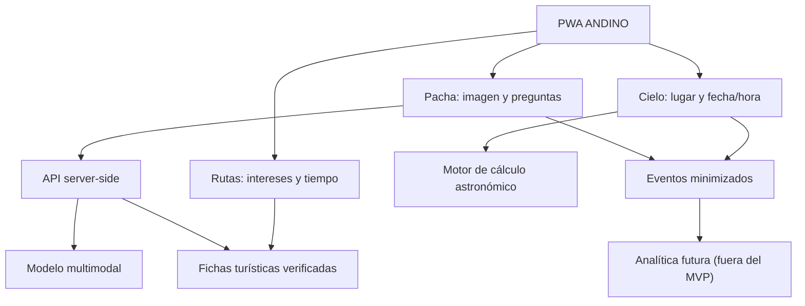

# ANDINO — Plan de proyecto | Cursor Hackathon Jujuy

> Versión 3 · 22 de noviembre de 2026  
> **Enfoque:** MVP de turismo inteligente + astroturismo + exploración espacial  
> **Equipo:** `lautioliver` (Desarrollador 1, Pacha e integración) y `jehp23` (Desarrollador 2, Cielo Andino y demo)  
> **Cliente objetivo:** Gobierno de la Provincia de Jujuy (hipótesis; no existe acuerdo confirmado)  
> **Contexto:** hackathon en el Tren Solar, con temática vinculada a Cursor y la comunidad espacial/SpaceX mencionada por el equipo. No implica patrocinio, integración ni colaboración oficial de SpaceX.

## 1. Visión

**ANDINO — Explorá la Tierra. Descubrí el universo.**

Plataforma turística que combina IA multimodal, mapas, información regional curada y astronomía computacional para descubrir Jujuy de día y explorar su cielo de noche. Una PWA para visitantes. Un eventual panel institucional es una extensión posterior, no un requisito del MVP.

**Propuesta diferencial:** una experiencia continua de **territorio → cielo → itinerario**. La astronomía es una capacidad real, no solo una estética espacial.

## 2. Problema y cliente

- **Visitantes:** información turística dispersa, dificultades para comprender lo que observan y para combinar destinos con actividades de observación del cielo.
- **Gobierno provincial (cliente potencial):** necesidad hipotética de administrar contenidos turísticos, difundir destinos y conocer qué información consultan los usuarios.
- **Validación pendiente:** entrevistar a turistas, prestadores y representantes del área de turismo; no asumir intención de compra ni cifras de impacto.

**Usuarios:** turistas nacionales e internacionales, residentes, estudiantes y operadores turísticos. **Administrador:** editor institucional. **Comprador potencial:** organismo provincial competente en turismo.

## 3. Experiencias del producto

### 3.1 Pacha — Explorá la Tierra (MVP P0)

El visitante fotografía un paisaje o elige un punto turístico. La IA combina descripción visual, ubicación opcional y fichas verificadas para explicar geografía, historia, patrimonio y recomendaciones relevantes.

**Flujo:** cámara/imagen → candidato de lugar → confirmación si hay incertidumbre → explicación con fuentes → pregunta de seguimiento → sugerencia de ruta.

No prometer reconocimiento universal de montañas ni inventar datos culturales.

### 3.2 Cielo Andino — Descubrí el universo (MVP P0 acotado)

Una vista del cielo calculada a partir de **latitud, longitud, fecha y hora** muestra objetos astronómicos seleccionados y su posición aproximada. La demo permite seleccionar un lugar y observar qué se vería desde allí de noche.

**MVP:** mapa celeste 2D o visualización simple, 3–5 objetos destacados, fichas educativas y una explicación asistida por IA. **Opcional:** orientación con sensores del teléfono si funciona de manera confiable.

**Criterio cultural:** los relatos y denominaciones astronómicas andinas deben proceder de fuentes verificables y, para una versión pública, contar con revisión de referentes culturales y lingüísticos. No equiparar automáticamente constelaciones occidentales con tradiciones andinas.

### 3.3 Rutas Andinas — Planificá tu aventura (MVP P1)

Recomendar un itinerario corto a partir de intereses, tiempo disponible y puntos turísticos curados. Incluir opcionalmente una parada de observación del cielo.

Para un producto real, las recomendaciones de observación deben considerar **nubosidad, fase lunar, contaminación lumínica, seguridad, acceso y horarios**; si esos datos no están disponibles, mostrar la ruta como sugerencia no verificada.

### 3.4 Salud Andina — Territorio y ecosistemas (futuro)

Mantener como posible módulo independiente de monitoreo comunitario de vegas y bofedales, sujeto a validación con especialistas. **Fuera del alcance del hackathon** para conservar foco turístico.

## 4. La demo diferenciadora

1. **Vista desde el espacio:** animación o mapa que sitúa a Jujuy en la Tierra y acerca la cámara hacia la Quebrada. Es visualización, no datos satelitales en tiempo real.
2. **Exploración terrestre:** cargar una foto tomada desde el Tren Solar; Pacha ofrece explicación contextual con fuentes.
3. **Exploración celeste:** alternar a Cielo Andino y calcular qué objetos se verían desde ese lugar a una hora nocturna seleccionada.
4. **Cierre turístico:** mostrar una recomendación sencilla de actividad local basada en el destino seleccionado.
5. **Visión institucional (pitch, no software):** explicar cómo un organismo provincial podría administrar contenidos en una versión futura.

**Mensaje para jurado:** «ANDINO conecta el patrimonio terrestre de Jujuy con su cielo: una nueva forma de descubrir el territorio y una herramienta para promoverlo». No afirmar que SpaceX provee tecnología o datos al producto.

## 5. Alcance priorizado

| Prioridad | Entregable | Definición de terminado |
|---|---|---|
| P0 | PWA mobile-first | Navegación clara y usable en móvil |
| P0 | Pacha | Foto → explicación respaldada por fichas → pregunta |
| P0 | Cielo Andino básico | Lugar + fecha/hora → objetos celestes calculados |
| P0 | Dataset curado | 3–5 puntos turísticos, fuentes y coordenadas aproximadas |
| P0 | Demo robusta | Imágenes precargadas y resultados demostrables ante mala conectividad |
| P1 | Rutas Andinas | Itinerario breve basado en destinos del dataset |
| Fuera del MVP | Panel institucional | Describirlo en el pitch; no implementarlo durante el hackathon |
| P2 | Vista Tierra desde órbita | Transición visual atractiva, sin bloquear funciones centrales |
| P2 | Voz, AR y sensores | Solo si están probados en el dispositivo real |

**Regla de corte:** si Pacha o Cielo no funcionan al llegar a la mitad del tiempo, eliminar P1/P2. Una demo integrada vale más que tres módulos incompletos.

## 6. Arquitectura



**Stack sugerido:** Next.js + TypeScript + Tailwind CSS; API multimodal configurable; PostgreSQL/Supabase para fichas y eventos; biblioteca astronómica con efemérides comprobables (por ejemplo Astronomy Engine o equivalente); mapa ligero opcional; despliegue en Vercel o equivalente.

**Separación importante:** los cálculos de posiciones celestes provienen del motor astronómico; la IA explica los resultados, **no inventa coordenadas ni visibilidad**.

### Datos mínimos

- `places`: id, nombre, región, coordenadas aproximadas, descripción, fuentes, imágenes autorizadas.
- `sky_objects`: id, nombre, tipo, ficha educativa y fuente.
- `itineraries`: id, lugares, duración estimada, advertencias, estado de validación.
- `interaction_events`: timestamp, módulo, lugar seleccionado, categoría; sin identificación personal obligatoria.

## 7. Diseño

**Identidad:** territorio andino + cielo nocturno; estética tecnológica sobria, evitando clichés culturales.

**Pantallas MVP:** Inicio (Tierra/Cielo) → Pacha (cámara) → Resultado con fuentes → Cielo (selector de hora/lugar y mapa). Ruta sugerida solo si sobra tiempo; panel institucional fuera del MVP.

**Momento visual central:** transición entre un paisaje de la Quebrada y el cielo nocturno calculado para ese mismo lugar.

## 8. Seguridad, precisión y ética

- Permisos explícitos de cámara y ubicación; opción manual sin GPS.
- No almacenar fotografías ni coordenadas precisas por defecto.
- Claves de IA en servidor, límites de uso y validación de archivos.
- Identificar respuestas inciertas y citar fuentes de patrimonio.
- No atribuir tradiciones astronómicas a comunidades sin respaldo.
- No prometer condiciones óptimas para astroturismo sin datos meteorológicos y de seguridad.
- Dashboard con métricas de **uso de la app**, nunca equivalentes a conteos de turistas.
- Sin uso de marcas o logos de SpaceX que sugieran asociación oficial.

## 9. Organización de desarrollo — dos personas

**Principio:** dividir por funcionalidades completas (*vertical slices*), no por frontend/backend. Cada desarrollador implementa interfaz, lógica y pruebas de su módulo; ambos comparten contratos mínimos y revisan los cambios críticos.

| Responsabilidad | Desarrollador 1 — `lautioliver` | Desarrollador 2 — `jehp23` |
|---|---|---|
| Módulo principal | **Pacha**: turismo, captura de imagen, IA y fuentes | **Cielo Andino**: mapa celeste y cálculo astronómico |
| Entrega P0 | Foto o destino → explicación con fuentes → pregunta | Lugar y fecha/hora → objetos celestes visibles y fichas |
| Responsabilidad transversal | Integración de `main`, API, despliegue y estabilidad | UX conjunta, pruebas en móvil y preparación de la demo |
| Colaboración | Revisar PRs de Cielo y definir contratos | Revisar PRs de Pacha y verificar navegación integrada |

### Repositorio y límites de propiedad

```text
andino/
├── app/
│   ├── page.tsx
│   ├── explorar/page.tsx
│   └── cielo/page.tsx
├── features/
│   ├── pacha/           # lautioliver
│   └── cielo/           # jehp23
├── shared/              # contratos acordados
├── data/                # fichas y ejemplos de demo
└── docs/plan.md
```

**Contratos antes de empezar:** `AndinoLocation { latitude, longitude, name }` y `ExplorationContext { location, timestamp, language }`. El paso Pacha → Cielo debe compartir la misma ubicación. No agregar un backend o base de datos si los datos estáticos resuelven el MVP.

**Git:** ramas breves `feat/pacha-*` y `feat/cielo-*`, PRs pequeños y revisión cruzada. `main` debe estar siempre desplegable. Integrar al menos una vez por hora; no esperar al final. Los cambios a `shared/` y configuración global se coordinan antes.

### Cronograma de referencia (7,5 horas; ajustar al evento)

| Tiempo | `lautioliver` | `jehp23` | Hito común |
|---|---|---|---|
| 0:00–0:30 | Scaffolding, API y contratos | Diseño base y dataset astronómico | Alcance P0 congelado |
| 0:30–1:30 | Pantalla Pacha y carga de imagen | Pantalla Cielo y selector de lugar/hora | Navegación funcional |
| 1:30–3:00 | IA + fichas turísticas curadas | Cálculos astronómicos + mapa simple | Dos flujos independientes |
| 3:00–4:00 | Pregunta de seguimiento y errores | Fichas de objetos y pruebas de cálculo | P0 funcional por módulo |
| 4:00–5:00 | Integración y revisión cruzada | Integración y revisión cruzada | Tierra → Cielo completo |
| 5:00–6:00 | Despliegue, fallback y correcciones | Pruebas en móvil y demo visual | Demo estable |
| 6:00–7:00 | Congelar código y apoyar pitch | Ensayar pitch y verificar dispositivo | Presentación ensayada |
| 7:00–7:30 | Reserva para contingencias | Reserva para contingencias | Entrega final |

**Regla de corte:** si a mitad del tiempo un flujo P0 no funciona, detener rutas, animaciones, voz y cualquier dashboard. Si falla el reconocimiento, usar selección manual de un destino; si falla la conexión, usar imágenes y respuestas precargadas identificadas como demo. No simular cálculos astronómicos como si fueran reales.

**Uso de agentes:** Cursor y, si resulta útil, el flujo ya conocido de Barrilete/bk-shell para tareas acotadas y revisión. No invertir tiempo del hackathon en configurar una nueva orquestación. La responsabilidad de integración sigue siendo humana.

## 10. Backlog

- [ ] AND-01: PWA mobile-first con navegación Tierra/Cielo.
- [ ] AND-02: Captura/carga de imagen y estados de error.
- [ ] AND-03: Dataset curado de 3–5 puntos del recorrido.
- [x] AND-04: Respuesta multimodal con fuentes y declaración de incertidumbre.
- [x] AND-05: Preguntas de seguimiento contextual.
- [ ] AND-06: Selector de lugar y fecha/hora para Cielo Andino.
- [ ] AND-07: Cálculo comprobable de posiciones de 3–5 objetos celestes.
- [ ] AND-08: Vista de cielo legible en móvil.
- [ ] AND-09: Navegación contextual desde Pacha a Cielo.
- [ ] AND-10: Demo con imágenes y contenidos precargados.
- [ ] AND-11 (P1): Itinerario turístico terrestre + astronómico.
- [ ] AND-12 (futuro): Dashboard de eventos agregados; **no implementar en el MVP**.
- [ ] AND-13 (P2): Animación orbital Tierra → Jujuy.

## 11. Criterios de éxito

- Una persona puede fotografiar o elegir un destino y obtener una explicación con fuentes.
- El mismo destino se utiliza para calcular una vista celeste en una fecha y hora seleccionadas.
- La demo deja claro qué datos son reales, qué partes son simuladas y qué funciones son futuras.
- Funciona en un teléfono real; existe un fallback para conectividad limitada.
- El pitch demuestra utilidad turística, relación auténtica con la astronomía y valor institucional potencial.

## 12. Riesgos

| Riesgo | Respuesta |
|---|---|
| Conectividad en movimiento | Dataset e imágenes precargadas; modo demo explícito |
| Alucinaciones del modelo | Fichas curadas y confirmación manual |
| Error astronómico | Motor de efemérides probado; no delegar cálculos a IA |
| Demasiado alcance | Pacha + Cielo como núcleo; recortar dashboard y animaciones |
| Relatos culturales inexactos | Usar solo fuentes verificadas y marcar contenido pendiente de revisión |
| Confusión sobre SpaceX | Presentar inspiración temática, no alianza ni integración |
| Adopción pública no validada | Identificar al Gobierno como cliente objetivo, no cliente confirmado |

## 13. Pitch de 3 minutos

**0:00–0:25 — Problema:** «Cuando visitamos Jujuy, vemos paisajes extraordinarios, pero muchas veces no conocemos sus historias. Y al caer la noche, tampoco sabemos qué estamos viendo en el cielo».

**0:25–1:15 — Tierra:** demo Pacha con imagen del recorrido, explicación y fuente.

**1:15–2:05 — Cielo:** desde el mismo lugar, seleccionar una hora nocturna y mostrar el mapa celeste calculado; explicar un objeto astronómico.

**2:05–2:35 — Turismo:** itinerario que conecta patrimonio terrestre y astroturismo; valor potencial para la promoción turística provincial.

**2:35–3:00 — Cierre:** «ANDINO: explorá la Tierra, descubrí el universo. Una experiencia para el visitante y una plataforma para acercar el patrimonio jujeño al mundo».

## 14. Decisiones pendientes

- [ ] Confirmar reglas y tracks oficiales del hackathon.
- [ ] Confirmar tamaño del equipo y tiempo real disponible.
- [ ] Elegir los 3–5 lugares y las fuentes de contenido.
- [ ] Definir proveedor de IA y créditos.
- [ ] Elegir motor astronómico y validar cálculos.
- [ ] Confirmar si habrá un dispositivo para probar orientación por sensores.
- [ ] Validar con un organismo turístico si el panel institucional responde a una necesidad real.

---

**Definición de terminado del MVP:** demo integrada **Tierra → Cielo** con contenido turístico respaldado, cálculos astronómicos reales, interfaz móvil estable y una historia clara de adopción institucional potencial. **No se requiere dashboard, autenticación, AR, voz, rutas completas ni infraestructura de producción.**
